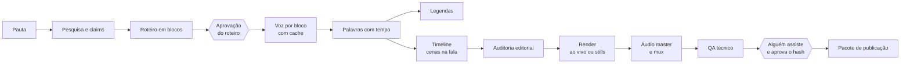

# Pipeline

O framework cobre da pesquisa ao QA: `darkroom pesquisa` monta o dossiê, o `darkroom roteiro`
(Claude Code ou Codex, pela assinatura) escreve o rascunho, e as afirmações só vão ao ar depois de conferidas por alguém.
Escolher o nicho, decidir a pauta e aprovar são humanos — é onde o julgamento editorial mora
(`docs/pauta-e-pesquisa.md`).

## Etapas

| Etapa | Comando | Sai em `out/` |
|---|---|---|
| Validar o episódio | `darkroom plan` | erros com o caminho do campo |
| Voz | `darkroom plan` / `render` | `voice/<hash>.wav/.json` (cache), `public/narration.wav` |
| Timeline e auditoria | `darkroom plan` | erros e avisos por cena |
| Legendas | `darkroom render` | `<id>.srt`, `<id>.vtt` |
| Áudio master | `darkroom render` | `master.wav` em -16 LUFS, ganho constante |
| Render | `darkroom render` | `chunks/` (ao vivo) ou `stills/` + `segments/` |
| Mux | `darkroom render` | `<id>-vN.mp4`, `render-manifest.json` |
| QA | `darkroom qa` | `qa-report.json`, `qa-fronteiras.jpg`, `frame-integrity.json` |

## Os dois gates humanos

1. **Roteiro**: antes de gastar voz. O `plan` mostra quantos caracteres faltam no cache; voz paga
   só sai com `--live`. Mudou uma frase depois de aprovado? Aprova de novo.
2. **Vídeo**: depois do QA técnico, alguém assiste ao vídeo inteiro e ouve a voz inteira. O manifesto
   começa com `humanReviewed: false` e guarda o SHA-256 do MP4: a aprovação vale para aquele arquivo.

Nenhum dos dois canais de origem publicou automaticamente. Upload é decisão humana.

## Fluxo de trabalho que funcionou

1. Escreva o roteiro em blocos e aprove.
2. Monte o episódio com voz `silence` (grátis, tempo estimado) e renderize trechos com
   `--frames=` para acertar cenas e enquadramento.
3. Troque para a voz real, rode `plan` para ver o custo, depois `render --live --detach`.
4. `darkroom qa`, olhe `qa-fronteiras.jpg`, assista ao vídeo inteiro.
5. Preencha `templates/publish-package.md`.
